<!--
  Pixel-style profile README for yadavnitesh86
  Requires the /assets folder (hero.svg, h-*.svg, footer.svg) next to this file in the profile repo.
  Palette: ink #0A0F1C · mint #3DDC97 · amber #FFB454 · violet #A78BFA · sky #5CC8FF
-->

<div align="center">



</div>

<br/>



I'm **Nitesh Yadav**, a BCA student focused on **Applied AI Engineering and Generative AI**.

I build AI-powered applications that combine **Machine Learning, Deep Learning, Large Language Models, Retrieval-Augmented Generation, AI Agents, APIs, evaluation, and deployment**.

My approach is simple:

> **Learn the fundamentals → build real systems → evaluate them → deploy them → improve them.**

My goal is to turn AI capabilities into **useful, reliable, and production-oriented applications**.

```text
$ whoami
nitesh-yadav

$ cat profile.txt
role       Applied AI Engineer · Generative AI · RAG · Agents
education  BCA · Shreyarth University (2024 – 2027)
location   Ahmedabad, Gujarat, India
stack      Python · FastAPI · LangGraph · PyTorch · Docker
status     open to AI/ML internships and entry-level roles
```

<br/>



<table>
<tr>
<td width="50%" valign="top">

### 🟪 Generative AI

* Large Language Models
* Transformers
* Prompt Engineering
* Hugging Face
* LLM Applications
* AI Agents
* Tool Calling
* Agentic Workflows

</td>

<td width="50%" valign="top">

### 🟩 Retrieval & RAG

* Retrieval-Augmented Generation
* Semantic Search
* Hybrid Search
* BM25
* Vector Search
* Reranking
* Metadata Filtering
* RAG Evaluation

</td>
</tr>

<tr>
<td width="50%" valign="top">

### 🟨 AI Application Engineering

* FastAPI
* Streamlit
* LangChain
* LangGraph
* API-based AI Systems
* AI Application Architecture
* Evaluation & Observability

</td>

<td width="50%" valign="top">

### 🟦 Engineering & Deployment

* Git & GitHub
* Docker
* REST APIs
* Cloud Deployment
* Model Serving
* Production-oriented AI Systems

</td>
</tr>
</table>

<br/>



**🟦 Programming & Data**

<p>


</p>

**🟨 Machine Learning & Deep Learning**

<p>


</p>

**🟩 Generative AI & RAG**

<p>


</p>

**🟪 AI Application Development**

<p>


</p>

**☁️ Cloud & Observability**

<p>


</p>

<br/>



My repositories focus on practical implementations of:

```text
                 ┌──────────────────────┐
                 │      AI SYSTEMS      │
                 └──────────┬───────────┘
                            │
          ┌─────────────────┼─────────────────┐
          ▼                 ▼                 ▼
       LLMs               RAG              Agents
          │                 │                 │
          ▼                 ▼                 ▼
     Transformers      Retrieval        Tool Calling
          │            + Search              │
          │                 │                 ▼
          └────────────┬────┴──────────── Agentic
                       │                    Workflows
                       ▼
                 AI Applications
                       │
                       ▼
              APIs + Evaluation
                       │
                       ▼
                  Deployment
```

👉 **Explore my repositories below to see my projects, experiments, and implementations.**

<br/>



<table>
<tr>
<td width="50%" valign="top">

### 🧭 [Waynora](https://github.com/yadavnitesh86/Waynora)
**Multi-Agent AI Travel Advisor** &nbsp;·&nbsp; `Sep 2026 – Present`

A LangGraph-powered travel advisor: **1 supervisor** orchestrating **3 specialist agents** across **4 travel domains**.

- MCP tools, persistent conversation state, prompt-injection guardrails, model fallback and observability
- Dockerized FastAPI backend on an Azure VM, with a Netlify-hosted frontend

<p>


</p>
<p>


</p>

</td>

<td width="50%" valign="top">

### 📄 [PaperWhisper](https://github.com/yadavnitesh86/PaperWhisper)
**AI-Powered Document Intelligence & RAG** &nbsp;·&nbsp; `Sep – Oct 2026`

A multi-user, production-shaped RAG backend: authenticated users upload documents and get answers grounded strictly in their own content.

- Hybrid retrieval, persistent chat history and per-user data isolation
- Evaluated on 100 RAGAS test cases; response latency cut from 60–120s to 20–30s

<p>


</p>
<p>


</p>

</td>
</tr>
<tr>
<td width="50%" valign="top">

### 🛠️ [RepoMind](https://github.com/yadavnitesh86/Repomind)
**Local AI Coding Agent** &nbsp;·&nbsp; `Aug – Sep 2026`

A local-first CLI coding agent that reads, edits and creates files from natural-language instructions.

- RAG over the codebase (Qdrant + FastEmbed) for context
- Git and filesystem tools with human approval before any file write; SQLite persistence, configurable LLM providers, GitHub Actions CI

<p>


</p>
<p>


</p>

</td>

<td width="50%" valign="top">

### 🧬 [QLoRA Fine-Tuning](https://github.com/yadavnitesh86/QLoRA-Fine-Tuning)
**Parameter-Efficient LLM Adaptation** &nbsp;·&nbsp; `Aug 2026`

TinyLlama-1.1B-Chat fine-tuned on 2,000 Dolly instruction examples with 4-bit NF4 quantization and rank-8 LoRA adapters on a T4 GPU.

- Evaluated on 200 held-out examples
- Only about 0.10% of model parameters trained

<p>


</p>
<p>


</p>

</td>
</tr>
</table>

<div align="center">

<a href="https://github.com/yadavnitesh86?tab=repositories"></a>

</div>

<br/>

My repositories cover different stages of my AI engineering journey, from **Machine Learning and Deep Learning** to **Generative AI, RAG, AI Agents, and AI application development**.

<br/>



### Applied AI Engineer

I aim to build AI products and systems around:

```text
LLMs
  +
RAG
  +
Information Retrieval
  +
AI Agents
  +
APIs
  +
Evaluation
  +
Deployment
```

I'm interested in opportunities involving:

**Applied AI · Generative AI · AI Engineering · RAG Engineering · LLM Applications · AI Agents · Machine Learning Engineering**

<br/>



<div align="center">


</div>

<br/>



<div align="center">

<a href="https://linkedin.com/in/yadav-nitesh-554aaa31"></a>
<a href="https://github.com/yadavnitesh86"></a>
<a href="https://instagram.com/yadavnitesh86"></a>
<a href="mailto:yadavnitesh8625@gmail.com"></a>

</div>

<br/>


